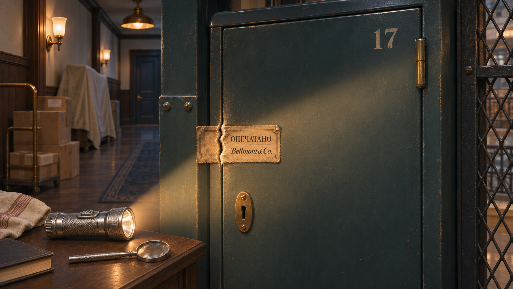
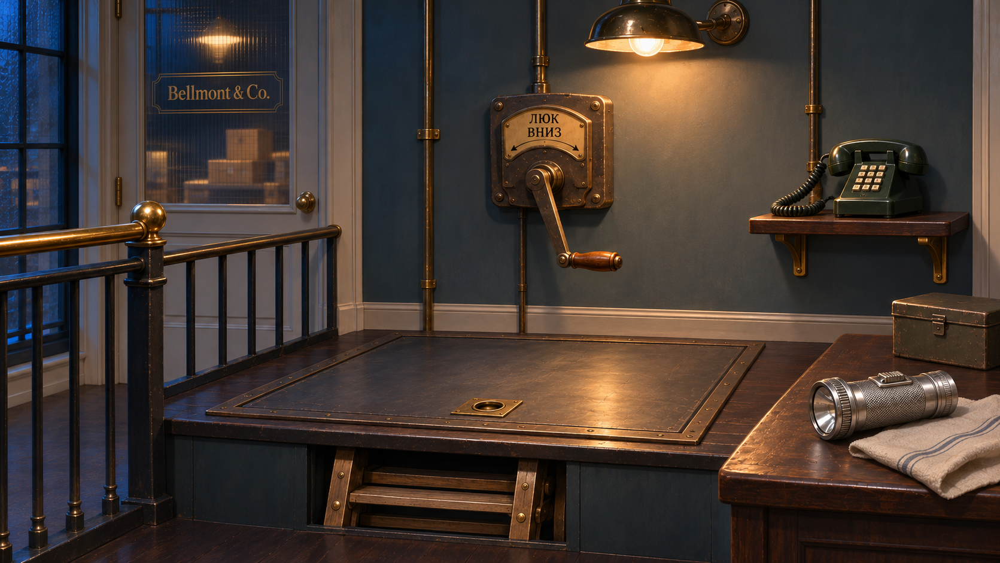
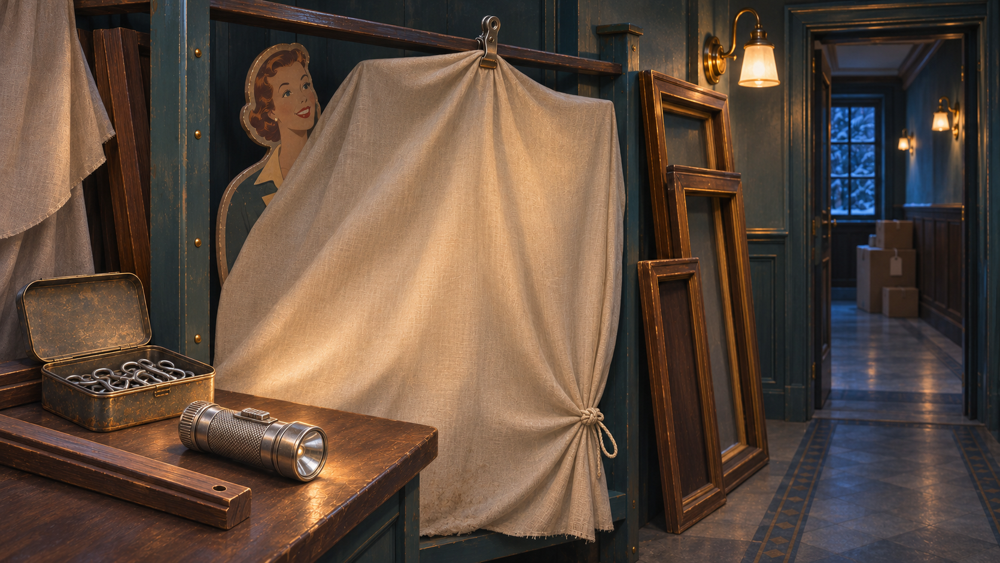
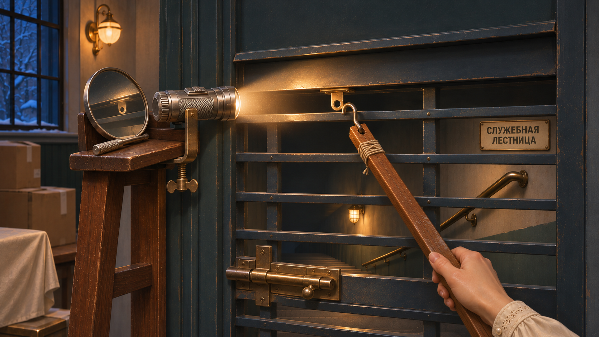
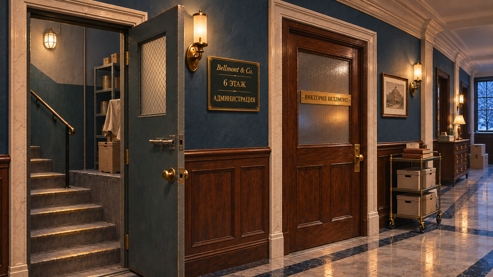

# День 4 — рабочие визуальные референсы

Последняя пересборка 23.11.2026 по изображениям прежних сцен: Амелия у стола, Томас у служебного коридора, Виктория в главном зале, грузовой лифт и комната отдыха. Это референсы постановки и атмосферы, не готовые послойные игровые фоны.

## Зафиксированные визуальные опоры

- Глубокие синие и сине-зелёные, молочный камень/отделка, тёмное дерево, латунь; тёплый свет рядом с холодным отражённым светом. Нельзя превращать служебную зону в ржавую охристую фабрику.
- Более простое служебное помещение принадлежит тому же универмагу; износ и пыль локальны.
- Фонарик Евы — **серебристый металлический цилиндрический**, с накаткой и ползунковым выключателем. Жёлтая новая модель отклонена.
- В первом лице — **женская кисть Евы**, естественный маникюр и светлая вышитая манжета по прежнему телефонному кадру. Мужская кисть и грубый рабочий рукав отклонены.
- Телефон — тёмно-зелёный, проводной; новый бордовый аппарат не используется как визуальная основа.
- Кадры не вводят новые лица, признания или предметы, указывающие на виновника.
- Референс не утверждает новые окна/двери, размеры механизмов и все архитектурные детали. Геометрия сверяется с прежними ракурсами, особенно выход в J06. Кабинет O06 остаётся отдельной комнатой.
- Пломба физически перекрывает щель дверцы и рамы. Боковая лестница за решёткой спускается вниз. Зеркало имеет опору, не висит в воздухе.

Источники предметов: `Bellmont_Amelia_First_Meeting_Interactive_v1.html`, ключи `receiverHand` и `flashlight`. Мир/материалы: прежние HTML Томаса, Виктории, грузового лифта и чая. Это не новое утверждение полного портрета Евы; [правила визуальной непрерывности персонажей](../characters/CHARACTER_VISUAL_CANON.md) сохраняются.

## Пять кадров

### R1. Шкаф 17 и свежий надрыв

### R2. Верхняя площадка и рабочий телефон

### R3. Витринный реквизит под чехлом

### R4. Рука Евы, фонарик и скрытая скоба

### R5. Отдельный выход возле кабинета Виктории

